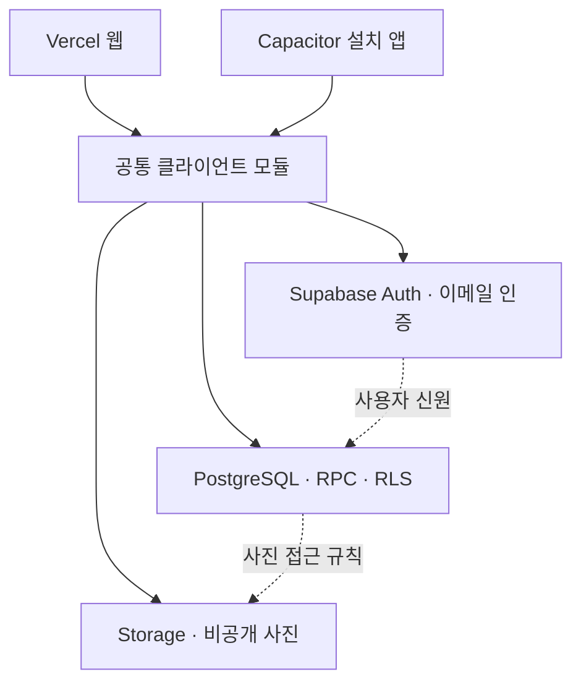

# 마음결 — 개발 현황·로드맵·블루프린트

문서 버전: 1.3 · 개정일: 2026-10-04 · 현황 기준: 아래 1~14절은 v1.1 당시 기록, 이후 개발 범위 변경은 16절, 현재 웹 호스팅 기준은 17절 참조

현재 웹 호스팅 기준은 승인된 [Cloudflare 운영 인계](CLOUDFLARE-HANDOVER-2026-09-15.md)와 [웹 호스팅 기준](HOSTING.md)을 따른다. 아래 Vercel 관련 기술·배포 설명은 당시 기록이며, 현재 기본 배포 대상을 뜻하지 않는다. M0~M5의 제품 수용 기준은 유지한다.

v1.2에서는 사용자 요청에 따라 배포 검증과 분리할 수 있는 안전성 수정·회귀 검사 개발을 병행하도록 범위를 조정한다. M0의 배포 승인 조건과 M1·M2의 실제 이용 완료 조건은 유지한다. 이 문서의 버전과 앱 버전은 별개다.

이 문서는 이후 개발의 기준이다. v1.1은 합의한 검증 조건과 개인적 경험·공유의 제품 정체성을 반영한 문서 작업이었다. 아래 1~14절의 당시 현황·미완료 표현은 역사적 기준으로 남기며, 후속 구현 근거는 16절의 연결 문서에 구분한다. 계획·수용 기준은 구현 완료를 뜻하지 않는다.

**현재 판정: 핵심 기능을 갖춘 시제품. 우선 과제는 운영 수정본의 재현성과 실제 기록 경험의 검증이다.**

**제품 목표: 개인의 경험과 감상을 사진과 글로 축적하고 다시 읽으며, 선택한 기록을 공유하고 다른 사람의 경험과 취향을 발견하는 앱. 와인은 첫 사용 맥락이고 필수 조건은 아니다.**

> **개인적 경험과 공유라는 Letterboxd적인 요소를 제품의 핵심으로 유지한다.** 개인 아카이브, 감상과 취향의 표현, 공개 기록의 발견, 작성자에 대한 관심, 공감과 대화가 이어져야 한다. 안정적인 저장과 공유·발견을 함께 완성하며, 공개 여부와 공개 범위는 사용자가 선택한다.

제품·화면·데이터·검증·베타 판단에서 이 원칙을 공통으로 적용한다. 저장 검증을 먼저 하는 개발 순서에서도 공유와 발견은 초기 핵심 경험의 완료 범위에 포함한다.

## 1. 현재 기준과 증거

| 대상 | 확인된 기준 | 판정과 한계 |
|---|---|---|
| GitHub 앱 소스 기준 | `BeautifulMind-JT/maeum-gyeol`, 업로드 준비 시 `main` = `78728e7cc79ef9a67c01d62ee9a1eabad6ba7ed8` | 재귀 파일 목록 192개, 결과 잘림 없음. 전체 보관 완료. 이번에 모든 파일을 다시 다운로드해 바이트 대조한 것은 아님 |
| 저장소 버전 | 루트 `package.json` = `0.7.0` | 운영 수정 반영 전 코드가 남아 있음 |
| 공식 웹 | https://maeum-gyeol.vercel.app/mobile/ | 기존 합의에 따라 공식 진입점으로 사용 |
| 현재 운영 배포 | `dpl_23WMbTb9dCCL8BR95PbViGnjELsb` | production, READY, 공식 도메인 연결 확인. READY는 사용자 흐름 검증 결과가 아님 |
| 배포 고유 주소 | https://maeum-gyeol-qjga5pezh-beautifulmind-jts-projects.vercel.app | 운영 별칭과 구별해 배포를 식별하는 주소 |
| 운영 수정본 | 앞선 작업에서 0.7.1로 보고된 발견 탭 수정 | 이번에 운영 `social-cloud.mjs`의 작성자 관계 명시와 GitHub 코드 차이를 직접 확인 |
| 배포와 커밋 연결 | 조회 응답의 배포 `meta`는 빈 객체 | 이번 응답으로는 배포와 GitHub 커밋의 연결을 증명할 수 없음. Git 연결 설정 자체의 유무를 단정하지 않음 |
| Supabase | 마음결 전용 `vmvtpolyszkyachlqlki` | v1.0 직접 조회에서 public의 `mg_` 테이블 11개 모두 RLS 활성화 확인. 후속 검토에서 정책 존재도 보고됐으나 이번 개정에서 재조회하지 않음. 실제 사용자 API·함수·사진 접근 검증은 남아 있음 |
| DB 적용 이력 | `shared_mindful_journal`, `social_archive`, `cloud_only_journal` | 3개 적용 이력 확인. 저장소 파일 버전명과 운영 이력 번호의 대조 필요 |
| 자동 검사 | 이전 복구 작업에서 루트 42개 + 모바일 4개 통과 | 총 46개는 과거 실행 결과. 이번 문서 작업에서 재실행하지 않음 |
| 실제 이용·설치 앱 | 이메일 인증, 사진 저장, 재접속, 최신 APK 업데이트 | 전체 흐름 및 최신 설치본의 완료 근거 미확보 |

근거: [GitHub 기준 커밋](https://github.com/BeautifulMind-JT/maeum-gyeol/commit/78728e7cc79ef9a67c01d62ee9a1eabad6ba7ed8), [기준 README](https://github.com/BeautifulMind-JT/maeum-gyeol/blob/78728e7cc79ef9a67c01d62ee9a1eabad6ba7ed8/README.md), [기준 package.json](https://github.com/BeautifulMind-JT/maeum-gyeol/blob/78728e7cc79ef9a67c01d62ee9a1eabad6ba7ed8/package.json). 배포와 DB 상태는 연결된 프로젝트의 읽기 전용 조회 결과다.

## 2. 구현 자산과 미완료 범위

| 영역 | 확보한 구현 | 다음 확인 |
|---|---|---|
| 디자인 | 1안 ‘여름의 표지’, 코발트 홈·노란 손글씨·흰 기록 화면, 오늘/발견/내 기록 | 실폰 화면, 글자 확대, 키보드, 오류·빈 상태에도 일관되는지 |
| 연습 | 알아차림 → 허용하기 → 돌아오기 → 머무르기, 3분 안내·일시정지·재개 | 화면 잠금, 백그라운드 복귀, 음성·타이머 정합성 |
| 계정 | 이메일 OTP 기반 로그인 | 실제 수신·만료·재전송·복귀·세션 만료 |
| 기록 | 와인 이름·빈티지·상황·마음 기록·돌아보기·검색·날짜별 보기 | 작성·수정·삭제 후 서버에서 다시 읽은 값과 화면 일치 |
| 초안 | 서버 전용 초안, 중복 요청 방지, 버전 충돌 처리 | 응답 유실·두 기기 충돌·앱 종료 전 미전송 상태 |
| 사진 | EXIF 제거, 본문/썸네일 변환, 비공개 저장소, 정리 대기열 | 부분 업로드 실패, 재접속, 참조 유지, 접근 철회 |
| 공유 | 공개 사본, 피드·프로필·좋아요·댓글·팔로우·소식 | 실제 API 조합, 비공개 돌아보기 제외, 철회 후 다른 계정 접근 |
| 운영 | 신고·차단·계정 삭제 경로 | 실제 처리 책임자, 오류 재시도, 계정 삭제 후 잔존 접근 |
| 플랫폼 | 웹·Capacitor Android/iOS 공통 소스 | 최신 서명 빌드, 기존 앱 업데이트, 실기기 동작 |
| 사업 검증 | 제품 방향과 시안 선택 | 반복 사용·추천·지불 의사에 관한 관찰 자료 |

소스에 기능이 존재하는 것과 실환경의 사용 가능 여부를 별도로 기록한다. 기존 공유·발견·프로필·반응·대화의 연결을 핵심 제품 경험으로 검증한다. 새 소셜 기능의 확장은 기존 흐름을 완결한 뒤 판단한다.

## 3. 먼저 해결할 두 가지 불일치

**발견 탭 수정의 소스 누락.** 기준 GitHub의 `social-cloud.mjs`는 피드와 대표 기록 조회에 `author:mg_profiles(name)`을 사용한다. 운영 파일은 `author:mg_profiles!mg_public_entries_owner_id_fkey(name)`으로 관계를 명시한다. 이는 이번에 직접 비교한 차이다. 운영본 전체 변경 목록은 아직 확정하지 않았으므로 이 두 줄만 옮기고 동기화 완료라고 판단하면 안 된다.

GitHub의 `cloud.mjs`에도 공개 목록·상세·댓글의 작성자 조회가 있다. 재개 시 운영본과 함께 대조한다. 관계를 명시해야 하는 조회에는 올바른 외래키를 사용하고, 실제 API가 의도한 작성자를 반환하는지 검증한다. 외래키 관계 선택 문법은 [Supabase 공식 조인 문서](https://supabase.com/docs/guides/database/joins-and-nesting)에 설명돼 있다.

기존 `tests/social.test.mjs`는 PGlite에서 SQL/RLS와 `mg_feed`를 직접 검사한다. 이 테스트가 유효하더라도 PostgREST의 관계 해석까지 검증하는 것은 아니다. 회귀 검사는 실제 클라이언트 조회와 같은 요청을 API 계층으로 보내는 방식으로 보완한다.

**DB 이력 번호 차이.** 이름은 대응하지만 번호가 다르다. 현재 확인한 것은 번호 차이이며 SQL 내용의 차이는 아니다.

| 의미 | GitHub SQL 파일 버전 | 운영 적용 이력 버전 |
|---|---|---|
| 기본 공유 기록 | `20260910050715` | `20260910052453` |
| 소셜 아카이브 | `20260911005457` | `20260911011426` |
| 서버 전용 초안 | `20260911045757` | `20260911062410` |

재개 시 SQL 내용·운영 스키마·적용 이력을 대조해 대응표를 만든다. 테이블·함수·트리거·권한·Storage 정책의 실제 적용 차이와 Auth·버킷 등 별도 설정의 사전 조건을 확인한다. 저장소의 변경 파일과 문서화한 설정으로 신규 환경의 필요한 구조와 API 동작을 재현한다. 운영 조회 성공만으로 신규 환경 재현을 통과 처리하지 않는다. 번호만 맞추려고 운영 SQL을 재실행하거나 적용 이력을 수정·삭제하지 않는다. 내용 차이를 확인한 뒤 필요한 전진 수정안을 결정한다.

## 4. 제품 블루프린트

첫 사용자 경험의 기준은 ‘연습하거나 바로 기록하고, 내 경험을 다시 읽고 싶어지며, 선택한 경험을 나누거나 다른 사람의 기록을 더 읽고 싶어지는가’다. 핵심 기록은 사진이나 와인 정보가 없어도 완성할 수 있어야 한다. 이는 다음 검증에서 확인할 제품 기준이다.

### 4.1 개인 아카이브와 공유·발견의 연결

| 제품 원칙 | 화면에서 확인할 경험 | 완료 판단 |
|---|---|---|
| 개인적 경험의 축적 | 사진·짧은 감상·날짜·상황이 내 기록에 쌓임 | 과거 기록을 찾아 다시 읽고 수정할 수 있음 |
| 취향과 작성자의 맥락 | 공개 기록에서 작성자·프로필·대표 기록·다른 공개 기록으로 이어짐 | 누구의 어떤 경험인지 이해하며 아카이브를 탐색할 수 있음 |
| 선택적 공유 | 사용자가 공개할 기록과 내용을 정하고 철회할 수 있음 | 비공개 원본·개인 돌아보기 보호와 공개 범위가 일치함 |
| 발견과 대화 | 발견·팔로잉에서 글을 읽고 기존 좋아요·댓글로 반응함 | 다른 계정과 읽기·공감·대화가 실제 API에서 연결됨 |
| 재방문 | 내 기록 또는 관심 있는 사람의 기록을 다시 읽음 | 재열람·추가 작성·공유·대화가 돌아오는 이유인지 관찰함 |

핵심 흐름은 **경험 → 기록 → 선택적 공개 → 발견 → 상세·작성자 아카이브 → 공감·대화 → 다시 경험하고 기록하기**다. 공유하지 않는 사용자도 개인 아카이브를 온전히 사용할 수 있어야 한다. 평점·리스트·추천 같은 신규 기능은 이번 확정 범위에 자동 추가하지 않는다.

### 4.2 화면별 역할

| 화면 | 주된 사용자 목적 | 유지할 구성 | 확인할 실패·빈 상태 |
|---|---|---|---|
| 오늘 | 지금 연습 시작, 최근 순간 다시 보기 | 선택한 여름 표지와 시작 버튼, 최근 기록 | 처음 방문한 빈 서재, 불러오기 실패 |
| 연습 | 짧은 안내를 따라 감각에 주의 기울이기 | 4단계, 진행·일시정지·재개·종료 | 백그라운드 복귀, 음성 중단, 중도 종료 |
| 기록 작성 | 경험을 부담 없이 남기기 | 짧은 글, 선택 사진·와인 정보, 기본 비공개 | 사진 실패, 미전송 내용, 다른 기기의 수정 |
| 내 기록 | 지난 경험을 찾고 다시 읽기 | 날짜·검색·필터·수정·삭제 | 결과 없음과 서버 오류를 구분 |
| 기록 상세 | 글과 사진을 편하게 읽기 | 흰 바탕, 읽기 쉬운 본문, 공개 범위 | 삭제된 글, 접근 불가, 사진만 실패 |
| 발견 | 공개된 경험과 관심 있는 작성자 찾기 | 공개·팔로잉 피드, 상세·프로필 연결, 기존 반응·댓글 | 빈 피드와 API 오류를 구분, 차단·철회 반영 |
| 프로필·작성자 아카이브 | 한 사람의 취향과 경험을 이어 읽기 | 공개 프로필·대표 기록·다른 공개 기록·팔로우 | 공개 기록 없음, 작성자 조회 실패, 비공개 노출 방지 |
| 계정 | 인증과 개인정보 관리 | 로그인·로그아웃·계정 삭제 | 인증 만료, 삭제 실패와 재시도 |

디자인의 기준은 기존 선택안이다. 이번 단계에서 새 시안이나 프레임워크 변경을 목표로 삼지 않는다. 모바일 360~430px을 주요 검증 범위로 하고, 큰 화면과 글자 확대도 읽기·조작에 지장이 없는지 확인한다. 화면 안에 GitHub·DB·배포 같은 개발 정보를 노출하지 않는다.

로그인은 연습 시작 전에 강제하지 않는다. 기록 저장에는 계정이 필요하다는 현재 정책을 유지한다. 로그인 과정이 완료된 연습 맥락을 잃게 하는지 확인한다. 사진을 공개하지 않은 상태에서 공개 피드로 보내지 않는다.

## 5. 기술 블루프린트

현재의 JavaScript 모듈·Capacitor·Supabase 구조를 유지한다. Vercel은 웹 앱을 전달하고, 기록·초안·사진의 기준 데이터는 Supabase에 둔다. 이번 계획에 별도 자체 서버나 프레임워크 재작성을 추가하지 않는다.

공통 모듈은 별도 서버가 아니라 각 웹·앱에 포함되는 클라이언트 코드다. GitHub의 특정 커밋에서 웹과 설치 앱을 만든다. 현재 존재하는 구조를 위 도식으로 정리했으며, 설치 앱의 출시 준비가 끝났다는 뜻은 아니다.

| 책임 | 기존 소스 영역 | 개발 원칙 |
|---|---|---|
| 화면·이동·연습 | `mobile/src/main.mjs`, `presentation.mjs`, `runtime.mjs` | 기존 화면 유지, 검증 중 드러난 흐름 오류 수정 |
| 저장 조정 | `server-journal.mjs` | 서버 응답과 요청 ID·버전을 기준으로 완료 판단 |
| 인증·공개 기록 | `cloud.mjs`, `cloud-ui.mjs` | 화면이 직접 같은 API 조합을 중복 구현하지 않도록 관리 |
| 소셜·사진 | `social-cloud.mjs`, `social-ui.mjs`, `photos.mjs` | 관계 조회·공개 범위·사진 접근을 같은 수용 기준으로 확인 |
| DB 변경 | `supabase/migrations/` | 소스와 운영 이력을 대응시키고 재현 가능한 전진 변경 |
| 빌드·캐시 | `mobile/build.mjs`, `scripts/build-vercel.mjs`, `sw.js` | 정확한 소스에서 생성, 새 화면 반영과 작성 중 입력 보호 |

기존 Sites/D1은 과거 데이터 접근·이전 경로로 보존한다. Vercel로 안내할 경로와 유지할 레거시 경로를 먼저 목록화한다. 이전 기록과 계정 삭제 경로를 검증하지 않은 채 사이트 전체를 일괄 리디렉션하거나 폐쇄하지 않는다.

## 6. 데이터와 저장 계약

| 데이터 | 현재 저장 위치 | 접근·변경 기준 |
|---|---|---|
| 사용자 인증 | Supabase Auth | 인증된 신원을 사용하고 계정 간 접근 분리 |
| 프로필 | `mg_profiles` | 공개 필드와 사용자 식별을 명확히 구분 |
| 비공개 원본 | `mg_entries` | 소유자만 접근, 공개 철회 후에도 원본 정책 유지 |
| 서버 초안 | `mg_drafts` | 계정별 초안, 요청 중복·버전 충돌 검사 |
| 공개 사본 | `mg_public_entries` | 사용자가 공개한 필드만 포함, 비공개 돌아보기 제외 |
| 반응·관계 | `mg_comments`, `mg_likes`, `mg_follows`, `mg_notifications` | 공개 범위·차단·중복·삭제 정책 일치 |
| 운영 보호 | `mg_reports`, `mg_blocks` | 신고 접근 제한과 차단 효과를 실제 계정으로 확인 |
| 사진 | 비공개 Storage `maeum-photos` | 소유권과 공개 상태에 맞는 접근, EXIF 제거 |
| 사진 정리 | `mg_media_gc` | 기록·초안 참조가 없는 파일만 정리 |

저장 흐름의 목표 계약은 아래와 같다. 기존 구현을 이 계약에 맞춰 검증하고 불일치만 수정한다.

| 상황 | 사용자에게 보여야 할 상태 | 완료 판단 |
|---|---|---|
| 입력 중·전송 중 | 저장 진행 상태 | 아직 저장 완료 아님 |
| 서버가 초안을 수락 | 초안 저장됨 | 서버의 해당 버전 재조회 가능 |
| 최종 기록 저장 | 저장 완료 | 기록 저장과 초안 정리가 일관되게 반영 |
| 응답만 유실 | 확인 또는 재시도 상태 | 같은 요청 ID로 결과 확인, 중복 기록 없음 |
| 두 기기 충돌 | 서버 내용과 현재 입력이 다름 | 다른 기기의 변경을 조용히 덮어쓰지 않음 |
| 오프라인·업로드 실패 | 미전송 상태와 가능한 복구 방법 | 저장되지 않은 내용을 완료로 표시하지 않음 |
| 공개 철회 | 나만 보기 | 신규 요청에서 공개 사본·연결 사진 접근 철회 |
| 삭제 처리 실패 | 삭제 미완료와 재시도 | 일부 처리 성공을 전체 삭제 완료로 표시하지 않음 |

새 기록·사진·초안을 기기에 영구 저장하지 않는 기존 요구를 유지한다. 세션과 공개 정적 파일의 기기 저장은 허용한다. 미전송 입력은 메모리에만 있어 OS 종료·탭 종료 시 사라질 수 있다. 이 제약을 숨기거나 브라우저 종료 경고만으로 유실을 막았다고 판단하지 않는다. 서버에 확인된 초안과 아직 보내지 못한 입력을 화면에서 구분한다.

공개 철회는 이후 서버 접근을 막는 동작이다. 다른 계정의 새로운 상세·사진 요청을 차단하고 공개 사본·댓글·좋아요·관련 소식을 의도대로 처리하며 작성자의 비공개 원본은 유지해야 한다. 철회 전에 확보한 사진 주소로 철회 후 새 다운로드를 요청하는 경우도 검사한다. 실제 사진 제공 경로를 확인하고, 서명 URL을 사용한다면 유효기간과 기존 URL의 접근 가능 시간을 별도로 검증한다. 새 URL 발급 차단만으로 사진 철회 완료를 보고하지 않는다. [Supabase 사진 제공 문서](https://supabase.com/docs/guides/storage/serving/downloads)

이미 다른 사람이 내려받은 파일이나 캡처를 회수할 수 있다고 약속하지 않는다. 앱이 보유한 이미지 Blob의 화면 표시·해제도 별도로 확인한다.

서비스 워커는 공개 정적 자산만 다룬다. 개인 기록·초안·API 응답·계정 설정을 오프라인 캐시에 넣지 않는다. 업데이트가 작성 중 화면을 강제로 새로고침하지 않아야 한다.

## 7. 단계별 개발 로드맵

기능 수나 달력 날짜 대신 아래 완료 조건으로 다음 단계 진입을 결정한다. 단계 명칭은 작업 묶음이며 새 앱 버전을 임의로 확정한 것은 아니다.

| 단계 | 목표·작업 | 완료 조건 | 다음 단계의 선행 조건 |
|---|---|---|---|
| M0 · 기준 버전 회복 | 운영 0.7.1 변경 목록 확보, 작성자 조회 회귀 검사, GitHub 반영, DB 이력 대응, 같은 소스 재빌드·배포 | 특정 커밋의 새 체크아웃을 고정 환경·잠금 파일로 빌드. 배포 대상 전체 목록·해시·누락·추가 파일 대조, 실제 작성자 조회 회귀 검사 통과, DB 내용 대조·신규 환경 재현 완료 | 모든 개발의 첫 단계 |
| M1 · 핵심 웹 이용 검증 | 실제 이메일 로그인, 연습, 초안·사진·기록 저장, 재접속·수정·삭제 | 아래 핵심 시나리오가 실제 계정·실폰에서 통과, 중대한 유실·노출 결함 없음 | M0 완료 |
| M2 · 공유와 실패 처리 검증 | 공개·발견·상세·작성자 아카이브·대화·철회·차단, 계정 분리, 요청 유실·충돌, 사진 부분 실패 | 다른 계정에서 발견→상세→프로필·다른 기록→반응·대화가 연결됨. 공개 범위·철회와 서버 상태 일치, 실패 후 재시도·복구 확인 | M1의 저장 흐름 안정화 |
| M3 · Android 업데이트 | 동일 기준 코드로 기존 서명 계보를 유지한 설치본 제작, 업데이트·로그인 복귀·사진·음성 확인 | 기존 설치를 삭제하지 않고 업데이트 성공, 서버 기록 유지, 실기기 이용 확인 | M1·M2 모두 통과하고 결과를 사용자가 직접 확인 |
| M4 · 제한 베타 | 제안 규모 5~10명, 2주 관찰. 사용 중 오류·재방문 이유·중단 이유 수집 | 가입부터 첫 저장 가능, 치명적 결함 정리, 재방문·이탈에 관한 실제 관찰 확보 | M1·M2 모두 통과하고 결과를 사용자가 직접 확인. Android 참여자는 M3도 통과 |
| M5 · 출시 판단·iOS·수익 검증 | 베타에서 확인된 가치 기준으로 개선, iOS 실기기·배포 준비, 운영·지원 점검 | 플랫폼별 수용 기준과 운영 책임 확보. 결제는 지불 의사와 제공할 유료 가치 확인 후 별도 설계 | M4 결과를 바탕으로 범위 결정 |

M1·M2 모두 통과하고 사용자가 결과를 확인한 뒤 Android 준비와 웹 베타를 병행할 수 있다. 개인 사용 7~14일은 관찰 기간 제안이며 별도의 개발 완료일이나 의무 대기 기간은 아니다. 다만 한 작업 회차에서 미완료 항목을 과도하게 동시에 추진하지 않는다. iOS 일정은 Mac/Xcode·서명·실기기 접근이 확보된 뒤 산정한다.

| 완료 단계 | 보고 가능한 범위 |
|---|---|
| M0 | 소스·빌드·배포 재현 및 해당 API 오류 수정 검증. 제품 전체 안정성은 미확인 |
| M1 | 실제 계정의 핵심 기록 이용 과정 검증 |
| M2 | 공유·발견·접근 제어·저장 실패와 복구 검증 |
| M1·M2 결과 사용자 확인 | Android 검증·제한 웹 베타 진입 가능 |

## 8. 다음 개발 회차: M0 작업 명세

이번 계획 다음에 개발 재개를 요청받으면 다음 범위부터 끝낸다. 현재 문서 작성 자체는 이 작업들을 실행한 것이 아니다.

| 순서 | 작업 | 남겨야 할 결과 |
|---|---|---|
| 1 | GitHub 최신 HEAD와 운영 배포를 다시 확인 | 조사 시점·전체 커밋 SHA·배포 ID, 다른 작업의 변경 유무 |
| 2 | 운영 파일과 기준 소스를 대조 | 발견 목록·대표 기록·상세·댓글 등 관련 변경 목록. 빌드 산출물 전체를 소스로 덮어쓰지 않음 |
| 3 | 작성자 관계 조회 회귀 검사 | 잘못된 조회가 실패하고 수정된 조회는 의도한 작성자를 반환하는 API 계층 검사 |
| 4 | DB 이력 내용 대조·신규 환경 재현 | 파일·운영 이력·실제 구조 대응표, 사전 설정, 신규 환경 API 동작 결과, 추가 수정 필요 여부 |
| 5 | 검증된 변경을 GitHub에 반영 | 범위가 작은 커밋 또는 검토용 PR, 테스트 결과 |
| 6 | 그 커밋을 새 작업 공간에서 빌드 | 잠금 파일·고정 도구 버전·설정 식별 정보·배포 대상 전체 파일 목록과 해시. 비밀값 제외 |
| 7 | 동일 산출물 배포와 확인 | 배포 주소, 대상 파일 전체 대조와 누락·추가 파일 확인, 발견·대표 기록·상세·댓글 작성자 조회 결과 |
| 8 | 완료 기록 작성 | 커밋·배포·DB 기준·확인 범위·미확인 항목. 복귀 대상의 검증 범위와 DB 호환성, 미확보 시 미확보 상태와 장애 대응 |

회귀 검사는 소스 문자열이나 DB SQL 직접 실행으로 대체하지 않는다. 고정된 동일 관계 구조·테스트 데이터·실제 PostgREST API에서 기존 조회는 관계 해석 오류로 실패하고 수정 조회는 의도한 작성자를 반환해야 한다. 빈 피드와 공개 글이 있는 피드·상세·대표 기록·댓글 작성자 조회를 포함한다. 운영 환경이 바뀌어도 재현 가능한 검사로 남긴다. 운영에서는 사용자 데이터에 영향을 주지 않는 읽기 확인을 사용하며, 쓰기 검증은 명시된 테스트 계정·기록으로 수행한다.

## 9. 실제 이용 검증 명세

일반 사용자 A·B 두 계정과 비로그인 브라우저를 구분한다. 운영 사용자 기록은 테스트 재료로 사용하지 않는다. 계정 A의 같은 기록을 새 세션과 다른 기기에서 다시 읽어 확인한다. API 검사에는 일반 사용자 권한을 쓰고 관리 권한으로 접근 제어를 우회하지 않는다.

| ID | 시나리오 | 통과 기준 |
|---|---|---|
| U01 | 비로그인으로 3분 연습 시작·중단·재개 | 의도한 흐름을 완료하고 타이머·음성·화면 상태가 맞음 |
| U02 | 실제 이메일 인증·만료 코드·재전송 | 정상 인증, 잘못된 코드의 명확한 실패, 맥락 보존 |
| U03 | 사진 없는 비공개 기록 작성 | 서버 확인 후 완료 표시, 새 세션에서 원문 일치 |
| U04 | 사진 포함 초안·기록 저장 | 글과 사진 재조회 가능, 다른 계정에서는 비공개 접근 불가 |
| U05 | 브라우저 종료 후 재접속·다른 기기 조회 | 확인된 서버 초안·기록만 정확히 복원 |
| U06 | 수정 후 다시 조회 | 수정된 내용과 버전 일치, 과거 값으로 조용히 되돌아가지 않음 |
| U07 | 공개 후 B·비로그인 상태에서 확인 | 의도한 공개 필드만 노출, 비공개 돌아보기 제외. B가 발견→상세→작성자 프로필·대표 기록·다른 공개 기록으로 이동하고 팔로우·좋아요·댓글 후 재조회 가능. 비로그인 허용 범위도 별도로 확인 |
| U08 | 공개 철회 | 신규 상세·사진 요청과 기존 사진 주소로 새 다운로드 차단 확인. 공개 사본·관련 반응 처리, 본인 비공개 원본 유지. 이미 받은 사본 회수는 보장하지 않음 |
| U09 | 기록 삭제와 삭제 실패 재시도 | 새 세션에서도 삭제 반영, 실패를 완료로 표시하지 않음 |
| U10 | 저장은 성공했지만 응답이 유실 | 같은 요청으로 확인해 중복 기록·사진 참조를 만들지 않음 |
| U11 | 두 기기에서 같은 초안·기록 수정 | 충돌을 표시하고 타 기기 변경과 현재 입력을 보존할 경로 제공 |
| U12 | 사진 원본 성공·썸네일 실패 등 부분 실패 | 기록에 깨진 참조가 확정되지 않음, 재시도·정리 가능 |
| U13 | 저장 중 네트워크 단절·세션 만료 | 미전송 상태 명확, 재인증·재시도에서 중복·타 계정 저장 없음 |
| U14 | A가 B를 차단, 신고 및 접근 변화 확인 | 기존 정책과 피드·댓글·반응의 동작이 일치, 신고 내용 접근 제한 |
| U15 | 전용 테스트 계정 삭제 | 계정·기록·사진 잔존과 이전 토큰 접근을 점검, 다른 계정 보존 |
| U16 | 새 웹 버전 설치·새로고침 | 새 화면 반영, 이전 캐시로 고정되지 않음, 작성 중 강제 재시작 없음 |

M1은 U01~U06·U09의 실제 흐름과 기본 계정 분리를 우선 확인한다. M2는 U07~U08·U10~U16을 묶어 검증한다. 모든 계층에서 동일한 검사를 반복하기보다 구체적인 실패 위험을 담당할 최소한의 검사를 둔다.

사진·기록의 성공은 서버 재조회로 확인한다. 오류가 사라졌거나 버튼이 눌렸다는 사실만으로 성공 처리하지 않는다. 계정 삭제 검사는 삭제해도 되는 전용 테스트 계정으로 한정한다.

## 10. 배포·운영 블루프린트

제안하는 배포 절차는 다음과 같다. 현재 자동화가 모두 구현돼 있다고 가정하지 않는다.

1. GitHub 기준 커밋에서 필요한 검사를 실행하고 고정된 환경으로 빌드한다.
2. 운영 설정의 후보 배포를 공식 도메인 자동 연결 없이 만들고 단계에 필요한 동작을 검증한다.
3. 검증한 배포를 공식 도메인에 연결하고 배포 대상 전체 파일과 실제 API를 확인한다.
4. 검증 범위·미확인 항목·복귀 기준을 기록한다.

일반 Preview를 운영으로 승격하면 재빌드가 발생할 수 있으므로 동일 산출물을 제공했다고 가정하지 않는다. 운영 설정으로 생성한 staged production 배포를 확인한 뒤 재빌드 없이 승격하는 흐름을 구분한다. 이 후보도 운영 DB에 연결되면 실제 서비스 데이터를 사용하는 환경이므로, 쓰기 검증은 전용 테스트 계정·기록으로 한정한다. [Vercel 배포 승격 문서](https://vercel.com/docs/deployments/promoting-a-deployment)

릴리스 기록에는 앱 버전, 전체 커밋 SHA, 빌드 도구·설정의 식별 정보, 산출물 해시, 배포 ID와 주소, DB 이력 기준, 검증 시각·시나리오·결과를 남긴다. 빌드 공개 메타데이터에는 비밀 키·토큰·개인 데이터를 넣지 않는다.

한 기능 수정은 가능한 한 하나의 검토 가능한 변경으로 묶는다. 운영에서 먼저 긴급 수정했으면 해당 수정의 소스 회수와 재현까지 같은 사건의 완료 조건에 포함한다. 다른 세션이 저장소를 변경했으면 최신 HEAD를 확인하고 통합하며 강제 덮어쓰지 않는다.

검증된 복귀 대상 배포의 커밋·검증 범위·잔여 결함·동작 가능한 DB 상태를 기록한다. 확보하지 못했다면 **복귀 대상 미확보**로 명시하고 장애 시 전진 수정·영향 기능 제한 등 적용 가능한 대응을 결정한다. 과거 배포라는 이유로 정상 복귀 대상으로 취급하지 않는다. M0만 통과한 배포는 전체 이용이 검증된 안정판이 아니며, M1·M2를 통과한 배포를 이후 변경의 복귀 기준으로 삼는다. 코드 배포를 되돌리는 것과 DB 스키마를 되돌리는 것은 별개다. DB 변경은 이전·새 앱의 공존 가능성을 확인하고, 사용자 기록을 지우는 재설치·전체 스키마 재실행을 복구 방식으로 삼지 않는다.

사진·DB의 서버 측 백업과 복구 가능성은 별도 점검 항목이다. 사용자가 기기에서 수동으로 백업·가져오기를 하는 메뉴를 다시 만드는 계획이 아니다. 실제 요금제의 보관 범위, 사진 포함 여부, 복구 절차를 확인하고 복구 연습 결과를 남긴다. 현재 백업이 검증됐다고 주장하지 않는다.

오류 기록은 실패한 동작·오류 코드·앱 버전·요청 식별자 위주로 최소화한다. 기록 본문, 사진, 이메일, 인증 토큰은 진단 로그에 넣지 않는다. 신고 대응·문의·사진 정리·계정 삭제 실패의 담당자와 처리 방법을 베타 전에 정한다.

기록 접근 제어 오류, 저장 완료 뒤 재조회 불가, 중복 생성, 다른 계정 노출, 공개 철회 실패는 다음 단계 진입을 막는 결함으로 취급한다. 미세한 여백·전환 효과 같은 개선은 이 결함들과 구분한다.

## 11. 역할·판단·사업 검증

| 주체 | 책임 |
|---|---|
| 개발 작업 | 소스 대조·수정, 필요한 검사, 재현 가능한 빌드·배포, 근거 기록 |
| 박준태 | 실제 휴대폰에서 핵심 경험 확인, 디자인·제품 범위 판단, 베타 초대 대상·공개 범위 결정 |
| 실제 테스트 계정 사용자 | 본인 이메일 인증과 계정 접근이 필요한 단계 수행 또는 승인 |
| 운영 책임자 | 신고·문의·삭제 실패 대응, 비용·백업·복구 점검. 베타 전에 담당 확정 |

검증 대상은 ‘내 경험을 남기고 다시 읽을 가치, 타인의 경험과 취향을 발견하고 대화할 가치가 있는가’다. 베타의 5~10명·2주는 제안하는 관찰 규모이며 통계적 사업성 증명의 표본은 아니다.

| 관찰 질문 | 수집할 최소 근거 | 해석 |
|---|---|---|
| 처음 기록을 남길 수 있는가 | 시작한 사람 수, 저장 완료·재조회 성공 수, 중단 지점 | 가입·작성 마찰을 찾음 |
| 다른 날 다시 기록하는가 | 관찰 기간과 참여 인원을 분모로 한 추가 작성 인원·중단 이유 | 반복 작성의 동기와 부담 확인 |
| 지난 기록을 다시 읽는가 | 내 기록을 재열람한 인원과 구체적 사용 사례 | 개인 아카이브의 가치 확인 |
| 다른 사람의 기록 때문에 돌아오는가 | 발견·프로필·팔로잉 재방문, 기록을 읽고 반응·대화한 사례 | 타인의 경험·취향·관계가 재방문 이유인지 확인 |
| 원하는 경험을 편하게 나누는가 | 공개·철회 시도와 성공, 공유를 선택하거나 꺼린 이유 | 선택적 공유의 가치와 공개 범위 이해 확인 |
| 와인이 없어도 쓰는가 | 와인 상황·그 외 상황의 실제 사용 사례 | 제품 범위를 실제 사용에 맞춰 결정 |
| 기록이 안전하다고 느끼는가 | 저장 실패·유실·공개 범위 혼선 사례 | 안정성·신뢰 문제를 우선 수정 |
| 추가로 돈을 낼 이유가 있는가 | 원하는 추가 가치와 선택 이유 | 유료 가이드 등은 검증할 가설로 취급 |

초기에는 수동 인터뷰와 비식별 최소 이벤트로도 판단할 수 있다. 새 분석 서비스를 즉시 도입하지 않는다. 수치는 분모와 함께 기록하고 소수 표본을 시장 전체의 선호로 확대 해석하지 않는다. 유료화 방식·가격·전환 목표는 이번에 확정하지 않는다.

## 12. 우선순위와 보류 항목

| 우선순위 | 작업 묶음 | 완료 조건 |
|---|---|---|
| P0 | 운영 수정 소스 회수·API 회귀 검사·커밋과 배포의 일치 | M0 충족 |
| P0 | 서버 저장·재접속·계정 분리·공개 철회 | M1·M2의 핵심 수용 기준 충족 |
| P0 | 개인 아카이브와 공유·발견·작성자 아카이브·대화의 연결 | 4.1 제품 원칙과 U07~U08 검증, M4에서 두 경험의 재방문 이유 관찰 |
| P1 | 실폰 가독성·키보드·음성·연결 실패 안내 | 핵심 화면에서 조작을 막는 문제 해소 |
| P1 | 서버 백업·복구, 신고·삭제·사진 정리 운영 | 베타 운영 책임과 복구 가능성 확인 |
| P1 | Android 서명·업데이트 설치 | M3 충족 |
| P2 | iOS·추가 가이드·유료화·추천 고도화 | 베타 근거와 플랫폼별 준비에 따라 선택 |

새 디자인 전면 교체, 프레임워크 재작성, 소셜 기능의 추가 확장, 검증되지 않은 개인화, 결제 구현, iOS와 Android의 동시 출시 약속은 지금의 완료 목표에 포함하지 않는다. 기존의 기능과 데이터는 사용자 요청 없이 제거하지 않는다.

## 13. 이후 완료 보고 양식

- 이번에 끝낸 사용자 문제:
- 기준 GitHub 커밋과 링크:
- 배포 주소와 배포 ID:
- 소스·산출물·배포 일치 확인:
- 관련 DB 적용 이력과 호환성:
- 직접 확인한 계정·기기·이용 과정:
- 실패·복구 시나리오의 결과:
- 아직 확인하지 못한 항목:
- 남은 결함과 다음 단계 진입 가능 여부:
- 복귀 대상 배포·검증 범위·DB 호환성, 미확보 시 상태와 대응:

이 문서 개정은 제품 정체성과 개발·검증 기준의 정리다. 현황 근거 중 운영 수정 파일 차이·DB 이력·RLS 활성화는 v1.0 조회 기록을 이어받았다. 이번 GitHub 문서 보관은 해당 앱 수정의 구현 완료를 뜻하지 않는다. 0.7.1 동기화와 실제 계정 검증은 앞으로 수행할 작업이다.

## 14. 근거와 조회 범위

1. [GitHub 기준 커밋](https://github.com/BeautifulMind-JT/maeum-gyeol/commit/78728e7cc79ef9a67c01d62ee9a1eabad6ba7ed8): 현재 main 조회와 192개 파일 목록 확인.
2. [README](https://github.com/BeautifulMind-JT/maeum-gyeol/blob/78728e7cc79ef9a67c01d62ee9a1eabad6ba7ed8/README.md): 기능·저장·검증 범위·기존 플랫폼 구조. 문서의 주장을 실제 이용 성공으로 간주하지 않음.
3. [social-cloud.mjs](https://github.com/BeautifulMind-JT/maeum-gyeol/blob/78728e7cc79ef9a67c01d62ee9a1eabad6ba7ed8/mobile/src/social-cloud.mjs), [cloud.mjs](https://github.com/BeautifulMind-JT/maeum-gyeol/blob/78728e7cc79ef9a67c01d62ee9a1eabad6ba7ed8/mobile/src/cloud.mjs): 작성자 조회와 기록·사진 API 구현 확인.
4. [운영 social-cloud.mjs](https://maeum-gyeol.vercel.app/mobile/social-cloud.mjs): 2026-09-14 조회 당시 외래키 관계를 명시한 코드 응답 확인. 운영 주소의 파일은 이후 바뀔 수 있음.
5. [social.test.mjs](https://github.com/BeautifulMind-JT/maeum-gyeol/blob/78728e7cc79ef9a67c01d62ee9a1eabad6ba7ed8/tests/social.test.mjs): SQL 직접 실행 방식의 기존 소셜 검사 범위 확인.
6. Vercel 프로젝트·배포 조회: 현재 배포 ID·READY·운영 도메인 확인. 화면 클릭·OTP·사진 업로드를 이번에 수행하지 않음.
7. Supabase 읽기 전용 조회: 11개 테이블의 RLS 활성화와 세 개 마이그레이션 적용 이력 확인. 사용자 기록 내용 조회·수정 없음.
8. [Supabase 조인 공식 문서](https://supabase.com/docs/guides/database/joins-and-nesting): `relation!foreign_key(columns)`를 통한 관계 선택 설명.

GitHub 링크는 비공개 저장소 접근 권한이 필요하다. 초기 46개 검사 통과와 이전 디자인 검증은 과거 실행 기록에 근거한다. 현재 운영 API 전체·DB 정책 전체·모든 배포 파일·설치 앱의 완전성을 재검사한 문서가 아니다.

## 15. 문서 변경 이력

| 버전 | 날짜 | 변경 범위 |
|---|---|---|
| 1.0 | 2026-09-14 | 개발 현황·로드맵·기술 및 데이터 경계·16개 실제 이용 검증 시나리오 작성 |
| 1.1 | 2026-09-14 | Letterboxd적인 개인 경험·공유·발견을 제품 원칙·화면·검증·베타에 반영. M0 재현·DB 대조·단계 진입·복귀·공개 철회 조건 명확화. GitHub 문서 보관 |
| 1.2 | 2026-09-14 | M0 배포 승인 조건을 유지하면서, 운영·사용자 데이터와 분리된 계정 전환·저장 대기열 안전성 개발을 병행하도록 조정 |
| 1.3 | 2026-10-04 | 기존 Cloudflare 운영 인계 승인을 현재 호스팅 기준에 연결. 당시 Vercel 기록과 현재 배포 절차를 구분하며 제품 완료 조건은 유지 |

문서의 기준 위치는 이 저장소의 `docs/BLUEPRINT.md`다. 계획 변경은 이 문서에 반영하며, 완료 근거가 없는 항목은 미완료로 남긴다.

## 16. 배포 검증과 분리한 개발 병행

사용자의 “할 수 있는 개발을 먼저 진행” 요청에 따라, M0 후보 배포의 미완료 검증이 운영과 분리 가능한 개발까지 막지는 않도록 한다.

- M0 배포 재개 기준: [M0 재개 기록](M0-RESUME-2026-09-14.md). 기존 후보는 이번 안전성 수정이 포함된 배포가 아니다.
- 이번 병행 개발: [계정 전환·저장 안전성 개발 기록](DEV-SAFETY-2026-09-14.md). 계정 전환 중 늦은 응답 처리, 저장 요청의 입력 보존, 반환 객체 격리, 미확인 요청 집계를 수정하고 오프라인 회귀 검사를 추가한다.
- 변경은 별도 개발 브랜치에서 검증한다. 운영 승격·실제 사용자 기록 수정·DB 또는 인증 정책 변경은 포함하지 않는다.
- 자동 검사 통과만으로 실제 이메일 로그인·사진·실폰 재접속, M0 배포 대조, M1·M2 완료를 선언하지 않는다. 변경 코드의 배포 검증은 기존 후보 검증과 구분한다.

## 17. 현재 웹 호스팅 기준과 검증

2026-09-15 [Cloudflare 운영 인계](CLOUDFLARE-HANDOVER-2026-09-15.md)에 기록된 사용자 승인에 따라, 현재 정적 웹 배포 대상은 Cloudflare Pages다. 인증·기록·사진은 기존 Supabase 계약을 유지한다. 새 호스팅 이전을 승인하거나 DB·인증 정책을 바꾸는 문서 개정이 아니다.

- 빌드·출력 폴더·공개 주소·배포 식별 방법은 [HOSTING.md](HOSTING.md)를 따른다. 기본 빌드는 `npm run build`, 출력은 `cloudflare-dist`다.
- M0의 소스·산출물·원격 배포 일치 검증은 Pages의 실제 배포 커밋과 `/version.json`, 전체 파일 목록·해시를 대조한다. Pages check 성공이나 로컬 빌드만으로 운영 배포와 사용자 이용을 완료 처리하지 않는다.
- Production branch, OAuth 복귀 주소, 중복 Workers 빌드 등 제공자 설정은 실제 값을 확인한다. 문서나 저장소 변경만으로 설정 적용을 주장하지 않는다.
- 기존 Vercel 배포와 수동 복구 빌드는 복귀 검증 범위에서 보존한다. 기존 호스트 연결 정리는 승인된 운영 인계 순서에 따라 Pages main 배포와 실제 앱 이용을 확인한 뒤 수행한다. 프로젝트·DB·Storage·계정을 정리 목적으로 삭제하지 않는다.
- 10절의 staged production 승격 설명은 당시 Vercel 절차다. 그 절차를 Pages에 그대로 적용하지 않으며, 검증할 커밋·산출물·대상 배포를 확인한다. M1·M2 실제 계정/기기 검증과 이후 단계의 진입 조건은 그대로 유지한다.
